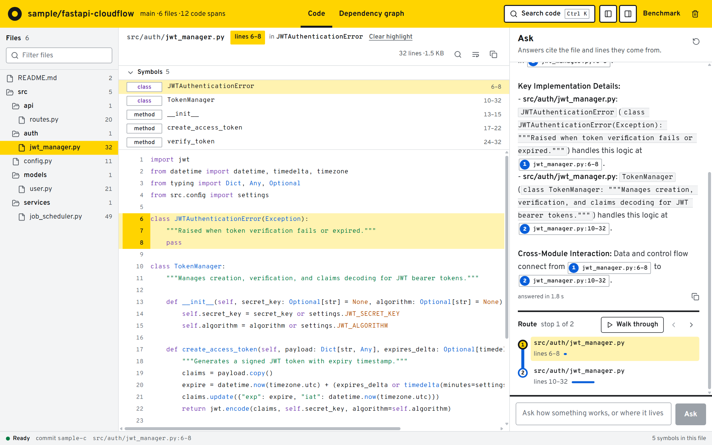
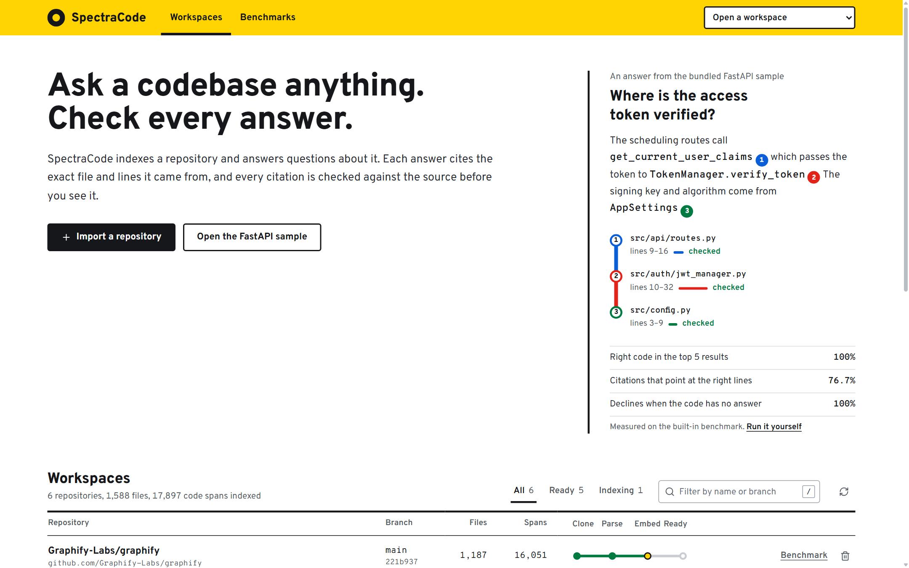

# 🧠 SpectraCode: AI-Powered Codebase Intelligence Platform

> **Category:** Generative AI · LLM Engineering · Code RAG · Developer Tools  
> **Status:** Production-Ready Foundation  
> **Website:** [spectracode.tech](https://spectracode.tech)  
> **Stack:** Next.js 15 (App Router), TypeScript, Tailwind CSS, FastAPI, PostgreSQL (`pgvector`) / SQLite, Tree-sitter, FastEmbed (ONNX), Pytest

[](https://fastapi.tiangolo.com)
[](https://nextjs.org)
[](https://tree-sitter.github.io/tree-sitter/)
[](#2--hybrid-rrf-retrieval--1-hop-ast-call-graph-expansion)
[](#-automated-testing--benchmark-results)

---

## 📌 Executive Summary

**SpectraCode** is an intelligent developer platform that analyzes source-code repositories and empowers engineers to rapidly understand unfamiliar codebases. Users can import public GitHub repositories with live Server-Sent Events (SSE) indexing telemetry, search source code via hybrid semantic and lexical retrieval, explore syntax trees and module dependency graphs, and chat with an AI assistant that answers technical questions with **strictly verified, clickable file and line number citations** (`[filepath:line_start-line_end]`) and an **interactive multi-file execution trace stepper**.

Unlike naive RAG systems that suffer from hallucinated references, isolated single-file context windows, and broken line intervals, SpectraCode combines **Tree-sitter Concrete Syntax Tree (CST) chunking**, **Reciprocal Rank Fusion (RRF)**, **1-Hop AST Call-Graph Context Expansion**, and a **two-stage grounding verification gate** to ensure that every architectural claim is verifiable down to the exact line of code.

---

## 📸 Visual Walkthrough: How SpectraCode Works

### 1. Developer Workspace with Grounded Citations & Multi-Hop Route Stepper
The core workspace features a synchronized three-pane layout: the **AST File Explorer** with symbol counts on the left, the **Code Viewer** highlighting cited line spans (`lines 6-8 in JWTAuthenticationError`) in the center, and the **Grounded AI Assistant** on the right. When an answer spans multiple files or execution hops, the **Route Stepper** renders an interactive transit map (`1 → 2`) with an auto-walkthrough mode that steps through cited files and highlights matching code spans automatically.



---

### 2. Clean Swiss Transit Dashboard & 4-Stage Indexing Line Map
The home dashboard provides an at-a-glance view of all imported workspaces, indexed file counts, total code spans, and live 4-stage ingestion status (`Clone` $\rightarrow$ `Parse` $\rightarrow$ `Embed` $\rightarrow$ `Ready`). Users can import any public GitHub repository or load the bundled sample with a single click.



---

### 3. Interactive Module Dependency Graph & Coupling Analysis
Switch to the **Dependency Graph** tab to explore repository architecture, inter-module imports, third-party library dependencies, coupling degrees, and circular import detection rendered as a clear transit station network.


---

### 4. Hybrid Search Modal (`Ctrl+K`)
Instant keyboard-driven code discovery powered by reciprocal rank fusion (dense vector cosine similarity + sparse identifier token matching).


---

### 5. Quantitative Benchmarking & Tailored AST Suites
SpectraCode includes an automated evaluation harness measuring retrieval recall, MRR, citation precision, and faithfulness against published engineering targets. For custom repositories, the **Dynamic AST Suite Generator** synthesizes targeted ground-truth queries directly from indexed classes and functions, accompanied by out-of-scope negative control checks.


---

### 6. Safe Workspace Deletion
Workspaces can be safely removed with immediate optimistic UI updates, background polling safety gates, and transit-themed confirmation dialogs.


---

## 🚀 Key Features

### 1. 🌲 AST-Aware Tree-sitter Chunking
- Parses Python, TypeScript, TSX, and JavaScript into Concrete Syntax Trees (CST).
- Chunks strictly along function, method, interface, and class boundaries rather than arbitrary character splits.
- Injects non-indexed structural metadata headers (`file_path`, `enclosing_scope`, `symbol_signature`, `imports`) so the retrieval model maintains full lexical and structural context.
- Guarantees 1-indexed, inclusive line number intervals matching GitHub and IDE conventions.

### 2. ⚡ Hybrid RRF Retrieval & 1-Hop AST Call-Graph Expansion
- **Dense Vector Search**: Generates 384-dimensional embeddings via local ONNX runtime (`BAAI/bge-small-en-v1.5`), eliminating external latency and API token costs.
- **Sparse Code Lexical Search**: Okapi BM25 over code-aware tokens: file path, symbol name and code, with `camelCase`, `PascalCase`, and `snake_case` identifiers expanded (`verifyJWTToken` $
ightarrow$ `verify jwt token`).
- **Reciprocal Rank Fusion (RRF)**: Dynamically weights vector vs. keyword importance ($\alpha = 0.35$ for explicit code identifiers/paths, $\alpha = 0.55$ for conceptual architectural queries) followed by score calibration.
- **1-Hop AST Call-Graph Context Expansion**:
  - Automatically extracts referenced function calls and type identifiers from top-ranked primary chunks (`_extract_referenced_symbols`).
  - Resolves cross-file symbol definitions in two passes: fast in-memory lookup across scored chunks followed by a batched SQL join across `ASTSymbol` and `CodeChunk` (`_expand_one_hop_chunks`).
  - Attaches `is_linked_hop=True` and `linked_from_symbol` metadata and serializes definitions into `<linked_hop_chunk>` prompt blocks—providing cross-file architectural context to the LLM **without polluting primary retrieval rank metrics (`Recall@K`, `MRR`) or benchmark citation precision**.

### 3. 🧭 Interactive Multi-File Flow Stepper & Trace Timeline
- **Grounded Citation Engine**: Streaming LLM responses emit canonical citation tokens (`[filepath:line_start-line_end]`) that are verified against retrieved chunk boundaries (`EXACT_MATCH`, `CLAMPED_TO_BOUNDS`, `INVALID_LINE_RANGE`, or `HALLUCINATED_FILE` rejection).
- **Multi-Hop Flow Stepper (`ExecutionTraceStepper.tsx`)**: When an AI response cites multiple code spans across files or execution hops, an interactive visual trace timeline automatically renders beneath the answer:
  - **Step-by-Step Navigation**: Jump sequentially (`Previous` / `Next` or direct pill selection) across cited execution hops (`1 → 2 → 3`).
  - **Auto-Walkthrough Mode**: Toggle `Play` / `Pause` to automatically step through the multi-file execution trace on a 2.4-second cadence.
  - **Code Viewer Synchronization**: Clicking any citation badge or trace step immediately loads the target file in the code viewer, scrolls smoothly to the span, and highlights the exact line range.

### 4. 📡 Real-Time Indexing Progress via Server-Sent Events (SSE)
- **Live 4-Stage Telemetry (`IndexingProgressTracker`)**: Streams real-time repository ingestion progress over `GET /api/v1/repositories/{repo_id}/progress-stream`.
- **Animated Modal Tracker (`RepoImportModal.tsx`)**: Visualizes the 4-stage pipeline (`Git Clone` $\rightarrow$ `AST Parsing` $\rightarrow$ `ONNX Vectors` $\rightarrow$ `Ready`) with live completion percentages, active file path inspection, processed file counters, and generated AST chunk counts.

### 5. 📊 Quantitative Grounded Benchmarking & Synthetic Suite Generator
- **Offline retrieval benchmark** (`backend/scripts/eval_retrieval.py`): 31 hand-labelled natural-language questions against a real, pinned repository (`psf/requests` v2.32.3), comparing a BM25 baseline, dense-only, sparse-only and the production hybrid retriever with bootstrap confidence intervals. See [Retrieval benchmark](#retrieval-benchmark-real-repository) for results.
- **In-app `/evaluation` dashboard**: Recall@K, MRR, citation precision/recall/F1, citation grounding and abstention on the bundled sample repo (5 curated queries) or a symbol-lookup smoke test generated from any indexed repo. These are smoke tests, not quality measurements: the sample repo is generated by this project and the generated questions name the symbols they look for.

### 6. 🕸️ Interactive Dependency & Coupling Graph
- Static import analysis extracting file-to-file import relationships, third-party packages, fan-in (popularity), fan-out (coupling), and circular dependency detection, backed by a two-tier in-memory and persistent metadata cache.

---

## 🏛️ System Architecture

```text
+---------------------------------------------------------------------------------------+
|                                   NEXT.JS 15 FRONTEND                                 |
|  - Developer Workspace & code viewer   - Multi-Hop ExecutionTraceStepper       |
|  - Streaming SSE AI Chat with Citations       - Live 4-Stage SSE Import Progress      |
|  - Interactive Module Dependency Graph        - Quantitative Benchmark Dashboard      |
+-------------------------------------------+-------------------------------------------+
                                            | HTTP REST / Server-Sent Events (SSE)
                                            v
+---------------------------------------------------------------------------------------+
|                                FASTAPI BACKEND RUNTIME                                |
|                                                                                       |
|  +-----------------------+  +-----------------------+  +---------------------------+  |
|  | Git Importer & SSE    |  | Tree-sitter AST       |  | Hybrid RRF Retriever      |  |
|  | Progress Tracker      |  | Semantic Chunker      |  | + 1-Hop Call-Graph Expand |  |
|  +-----------+-----------+  +-----------+-----------+  +-------------+-------------+  |
|              |                          |                            |                |
|              v                          v                            v                |
|  +--------------------------------------------------+  +---------------------------+  |
|  |         PostgreSQL 16 (pgvector) / SQLite        |  | Grounded Citation Engine  |  |
|  | (Repos, Files, ASTSymbols, CodeChunks, Vectors)  |  | (Interval Clamp & Gate)   |  |
|  +--------------------------------------------------+  +---------------------------+  |
+---------------------------------------------------------------------------------------+
```

### End-to-End Retrieval & Grounded Generation Flow
1. **Query Normalization**: `CodeQueryNormalizer` splits `camelCase`, `PascalCase`, and `snake_case` tokens while `HybridCodeRetriever` computes dynamic $\alpha \in \{0.35, 0.55\}$.
2. **Parallel Hybrid Retrieval**: FastEmbed ONNX generates the query vector for batch cosine similarity alongside rapid token overlap + selective Levenshtein fuzzy matching, fused via Reciprocal Rank Fusion (RRF) and score calibration.
3. **1-Hop AST Call-Graph Expansion**: Referenced symbols in the top primary chunks are resolved against `ASTSymbol` definitions across the repository and appended with `is_linked_hop=True` (`<linked_hop_chunk>`).
4. **Pre-Generation Abstention Gate**: `GroundedCitationEngine.should_abstain_pre_generation` verifies both minimum chunk relevance score and stem-tolerant lexical query term coverage over primary chunks.
5. **Line-Numbered Grounded Generation & Verification**: The LLM streams explanations with `[filepath:start-end]` markers, which are verified/clamped against retrieved intervals and rendered into interactive citation badges and the `ExecutionTraceStepper`.

---

## 🛠️ Technology Stack

| Component | Technology | Rationale |
| :--- | :--- | :--- |
| **Frontend** | Next.js 15 (App Router), React 18, TypeScript | High-performance developer workspace, SSE streaming, and trace UI |
| **Code Viewer** | Custom React code viewer, Tailwind CSS | Syntax highlighting, cited-line highlights, and scrolling to the cited range |
| **Backend** | Python 3.11+, FastAPI, Uvicorn | Asynchronous, high-throughput REST and Server-Sent Events (SSE) API |
| **Source Parsing** | Tree-sitter (`python`, `typescript`, `javascript`) | C-compiled syntax tree analysis, symbol extraction, and 1-hop call-graph resolution |
| **Embeddings** | FastEmbed (`BAAI/bge-small-en-v1.5`) | Zero-cost, low-latency local ONNX vector inference (384 dimensions) |
| **Database** | PostgreSQL 16 (`pgvector`) / SQLite (`aiosqlite`) | Production `pgvector` support with zero-config SQLite local development fallback |
| **Testing** | Pytest, `pytest-asyncio`, HTTPX | 56 unit & integration tests, run in CI |
| **Deployment** | Docker, Docker Compose | Unified multi-container orchestration |

---

## 🔌 API Endpoints Overview

| Method | Endpoint | Description |
| :--- | :--- | :--- |
| `POST` | `/api/v1/repositories/import` | Import a GitHub repository or built-in sample (`sample:fastapi`) and trigger background indexing |
| `GET` | `/api/v1/repositories` | List all indexed and in-progress repositories |
| `GET` | `/api/v1/repositories/{repo_id}` | Retrieve repository metadata, indexing status, file count, and chunk count |
| `GET` | `/api/v1/repositories/{repo_id}/progress-stream` | **SSE Stream**: Live 4-stage indexing progress (`cloning` $\rightarrow$ `parsing_ast` $\rightarrow$ `embedding` $\rightarrow$ `ready`) |
| `GET` | `/api/v1/repositories/{repo_id}/tree` | Retrieve hierarchical file explorer tree with language and line metrics |
| `GET` | `/api/v1/repositories/{repo_id}/files/{file_id}` | Fetch raw source file content and extracted file-level AST symbols |
| `GET` | `/api/v1/repositories/{repo_id}/symbols` | Search extracted `ASTSymbol` definitions (`class`, `function`, `method`, `interface`) |
| `GET` | `/api/v1/repositories/{repo_id}/dependencies` | Compute or fetch cached static module dependency graph and coupling metrics |
| `POST` | `/api/v1/repositories/{repo_id}/search` | Execute Hybrid RRF search + 1-Hop AST Call-Graph expansion with score breakdown |
| `POST` | `/api/v1/repositories/{repo_id}/chat/stream` | **SSE Stream**: Grounded AI chat streaming tokens, verified citations, and 1-hop context |
| `POST` | `/api/v1/repositories/{repo_id}/evaluate` | Run the quantitative retrieval & citation grounding benchmark suite |
| `GET` | `/api/v1/repositories/{repo_id}/evaluations` | List historical benchmark evaluation runs and sample-level metrics |

---

## 🚦 Quick Start Guide

### Option 1: Local Development (Zero Docker Requirement)

#### 1. Backend Setup
```bash
# Navigate to backend
cd backend

# Create and activate a virtual environment
python -m venv .venv
# PowerShell:
.\.venv\Scripts\Activate.ps1
# macOS / Linux:
# source .venv/bin/activate

# Install dependencies
python -m pip install -r requirements.txt

# Run FastAPI server (runs on http://localhost:8000)
python -m uvicorn app.main:app --reload --port 8000
```
*Note: Running `python -m uvicorn` invokes Uvicorn directly through the active Python interpreter (preventing `PATH` lookup failures when global `Scripts` directories are not on `PATH`). On first startup, SpectraCode automatically seeds and indexes the built-in `fastapi-cloudflow` microservice sample repository.*

#### 2. Frontend Setup
```bash
# Navigate to frontend in a new terminal
cd frontend

# Install dependencies
npm install

# Start development server (runs on http://localhost:3000)
npm run dev
```
Open **[http://localhost:3000](http://localhost:3000)** in your browser.

---

### Import limits

Imports that exceed any of these limits stop with a readable error shown on the dashboard, instead of filling the disk or tying up the indexing worker. Override them as environment variables or in `backend/.env`:

| Setting | Default | What it bounds |
| :--- | :--- | :--- |
| `MAX_CHECKOUT_MB` | `250` | Working-tree size after cloning (`.git` excluded); an oversized checkout is deleted |
| `MAX_INDEXED_FILES` | `3000` | Source files indexed (files over 1 MB, binaries, hidden folders and dependency or build folders such as `node_modules` and `dist` are already skipped) |
| `MAX_CHUNKS` | `5000` | Code chunks embedded; roughly 15–20 minutes at the ~5 chunks/s measured on a laptop CPU |
| `INDEXING_TIMEOUT_SECONDS` | `1800` | Wall-clock time for the whole indexing run |

### Option 2: Docker Compose (Full Production Stack)

```bash
# Start PostgreSQL (pgvector), Redis, Backend, and Frontend
docker-compose up --build
```

---

## 🧪 Automated Testing & Benchmark Results

SpectraCode includes a 56-test automated suite in `backend/tests/` (run in CI on every push):

```bash
cd backend
python -m pytest tests/ -v
```

### Test Suite Breakdown:
- `test_ast_chunker.py`: Verifies Tree-sitter Python & TypeScript parsing, symbol extraction, docstring binding, and 1-indexed line intervals.
- `test_hybrid_retriever.py`: Verifies `CodeQueryNormalizer` identifier splitting, dynamic $\alpha$ tuning, vectorized batch cosine similarity, and 1-hop AST symbol extraction (`_extract_referenced_symbols`).
- `test_citation_engine.py`: Verifies exact interval containment, clamped boundary overlaps, hallucinated file rejection, and pre-/post-generation abstention gates.
- `test_evaluator.py`: Verifies `Recall@K`, `MRR`, `Citation Precision`, `Citation Recall`, `Citation F1`, citation grounding (`faithfulness`), and dynamic AST benchmark suite generation.
- `test_llm_service.py`: Verifies Gemini grounded generation, visible fallback to template responses on API/network failures without leaking source code to logs, SSE generation-source reporting, and JSON log formatting.
- `test_api.py`: Verifies `/health`, `/`, and repository lifecycle API endpoints.
- `test_import_limits.py`: Checkout-size, file-count, chunk-count and indexing-timeout limits fail with a clear message.
- `test_sample_identifier.py`: Only the exact `sample:fastapi` identifier selects the bundled demo repo.
- `test_retrieval_eval.py`: BM25 baseline, Recall@K / MRR relevance rules, bootstrap intervals and suite validation.

### Retrieval benchmark (real repository)

```bash
cd backend
python scripts/eval_retrieval.py eval/suites/requests_v2_32_3.json
```

The script clones `psf/requests` at commit `0e322af8` (tag v2.32.3), indexes it with the normal pipeline into its own database under `backend/data/eval/` (never the dev database), and scores 31 hand-labelled questions. Indexing takes about 2–3 minutes the first time; later runs reuse it. Results are deterministic and saved to [`backend/eval/results/requests_v2_32_3.json`](backend/eval/results/requests_v2_32_3.json).

761 chunks (source, tests and docs are all indexed). Mean over queries, with 95% bootstrap intervals:

| Mode | Recall@5 | Recall@10 | MRR@10 |
| :--- | :--- | :--- | :--- |
| BM25 (keyword baseline) | 0.63 [0.47, 0.79] | 0.73 [0.58, 0.87] | 0.51 [0.37, 0.66] |
| Sparse signal only (BM25 inside the hybrid) | 0.63 [0.47, 0.79] | 0.73 [0.58, 0.87] | 0.50 [0.37, 0.66] |
| Dense only (`bge-small-en-v1.5`) | 0.71 [0.55, 0.85] | 0.85 [0.73, 0.97] | 0.57 [0.44, 0.70] |
| **Hybrid (production)** | **0.77** [0.63, 0.90] | **0.87** [0.74, 0.97] | **0.67** [0.53, 0.81] |

The hybrid's sparse signal is BM25 over the stored chunk tokens, so it nearly matches the BM25 baseline row; the small MRR difference comes from the stored tokens also including the symbol name.

What this does and does not show:
- **Hybrid beats BM25** on all three metrics. Paired differences: Recall@5 +0.15 [+0.03, +0.27], Recall@10 +0.15 [+0.05, +0.26], MRR@10 +0.16 [+0.09, +0.24].
- **Hybrid is not measurably better than dense-only**: Recall@10 +0.02 [−0.10, +0.13], MRR@10 +0.09 [−0.03, +0.22]. On this suite the keyword signal mainly helps ranking, not coverage.
- 31 queries is small, hence the wide intervals. All of them were written by the same person who chose the ground truth after reading the function list, which favours lexical matching; queries are tagged by author so independently written ones can be reported separately.
- The BM25 change below was judged on the same 31 queries that exposed the problem, so it still needs confirming on held-out queries.
- Ground truth only counts implementation code, so a highly ranked docs page explaining the same behaviour is scored as a miss.

#### History: replacing the custom sparse score with BM25

The first version of this benchmark showed that the original sparse score (substring token overlap + `rapidfuzz` partial ratio) was far weaker than BM25 (Recall@10 0.50 vs 0.73), and that the hybrid was not measurably better than either baseline (0.68 / 0.82 / 0.55 for Recall@5 / Recall@10 / MRR@10). Replacing it with BM25, with no other tuning, changed the hybrid by Recall@5 +0.10 [−0.03, +0.24], Recall@10 +0.05 [−0.06, +0.16] and MRR@10 +0.11 [+0.04, +0.19]: a clear ranking improvement, not a clear recall improvement. Three queries were fixed and one regressed (`bad_status_exception`). Mean query latency fell from about 385 ms to 320 ms.

The in-app `/evaluation` page's "citation grounding" metric (stored as `faithfulness`) only checks that cited line ranges fall inside retrieved chunks. It does **not** check that the generated answer's claims are true.

---

## 📁 Repository Structure

```text
SpectraCode/
├── backend/
│   ├── app/
│   │   ├── api/
│   │   │   ├── routes/
│   │   │   │   ├── repositories.py    # Import, SSE progress-stream, tree, files, symbols, dependencies
│   │   │   │   ├── search.py          # Hybrid RRF + 1-hop AST search endpoint
│   │   │   │   ├── chat.py            # Streaming SSE chat with verified citations
│   │   │   │   └── evaluation.py      # Quantitative benchmark runner & tuning
│   │   │   └── router.py
│   │   ├── core/
│   │   │   ├── config.py              # Pydantic settings & environment configuration
│   │   │   └── logging.py             # Structured JSON logging formatter
│   │   ├── db/
│   │   │   ├── session.py             # Async engine & schema lifecycle
│   │   │   └── models.py              # SQLAlchemy models (pgvector + SQLite)
│   │   ├── ingestion/
│   │   │   ├── ast_chunker.py         # Tree-sitter AST parser & semantic chunker
│   │   │   ├── git_importer.py        # Safe sandboxed GitHub clone & sample generator
│   │   │   ├── dependency_analyzer.py # Module import graph & coupling metrics
│   │   │   └── worker.py              # Async indexing coordinator & IndexingProgressTracker
│   │   ├── retrieval/
│   │   │   ├── embeddings.py          # FastEmbed ONNX local vector inference
│   │   │   └── hybrid_retriever.py    # Dense + Sparse + RRF + 1-Hop AST Call-Graph expansion
│   │   ├── generation/
│   │   │   ├── citation_engine.py     # Grounded citation parser, <linked_hop_chunk> & interval gate
│   │   │   └── llm_service.py         # Streaming grounded answer generator
│   │   ├── evaluation/
│   │   │   ├── benchmark_dataset.py   # Curated test queries with ground-truth spans
│   │   │   └── evaluator.py           # Recall@K, MRR, Citation Precision/Recall/F1, citation grounding
│   │   └── main.py                    # FastAPI application entrypoint
│   ├── tests/                         # 56 unit & integration tests
│   ├── Dockerfile
│   └── requirements.txt
├── frontend/
│   ├── src/
│   │   ├── app/
│   │   │   ├── page.tsx               # Modern Developer Dashboard
│   │   │   ├── evaluation/page.tsx    # Quantitative Benchmark & Evaluation Dashboard
│   │   │   └── repos/[id]/page.tsx    # 3-Pane Intelligence Workspace
│   │   ├── components/
│   │   │   ├── Navbar.tsx
│   │   │   ├── FileExplorer.tsx       # Tree file hierarchy with language badges
│   │   │   ├── CodeViewer.tsx         # Code viewer with line range highlights
│   │   │   ├── ChatInterface.tsx      # Streaming AI chat with clickable citations
│   │   │   ├── ExecutionTraceStepper.tsx # Interactive multi-hop flow stepper & auto-walkthrough
│   │   │   ├── SearchModal.tsx        # Hybrid search modal (⌘K)
│   │   │   ├── DependencyGraph.tsx    # Interactive module coupling visualizer
│   │   │   └── RepoImportModal.tsx    # 1-Click import with live 4-stage SSE progress tracker
│   │   ├── lib/api.ts                 # Typed client for REST & SSE backend endpoints
│   │   └── styles/globals.css
│   ├── Dockerfile
│   └── package.json
├── docs/
│   ├── ARCHITECTURE.md                # Detailed system design
│   ├── RAG_PIPELINE.md                # Code chunking, RRF & 1-hop expansion details
│   ├── EVALUATION_REPORT.md           # Benchmark results & metrics
│   └── SECURITY.md                    # Untrusted input policy & sandboxing
├── docker-compose.yml
└── README.md
```

---

## 🎯 Recruiter Demonstration Walkthrough

When presenting SpectraCode to recruiters, hiring managers, or engineering teams:

1. **Live SSE Repository Ingestion**:
   - Launch SpectraCode (`http://localhost:3000`) and open the **Import Repository** modal.
   - Import a repository or click **"Load Sample Repository"** (`fastapi-cloudflow`).
   - Watch the **4-Stage SSE Progress Tracker** animate smoothly through `Git Clone` $\rightarrow$ `AST Parsing` $\rightarrow$ `ONNX Vectors` $\rightarrow$ `Ready`, streaming the active file name and chunk count in real time.
2. **AST Code Explorer & Code Viewer**:
   - Open the repository workspace. Browse the file tree (`src/auth/jwt_manager.py`, `src/services/job_scheduler.py`, `src/api/routes.py`).
   - Click AST Symbol badges (`TokenManager`, `verify_token`, `DistributedScheduler`) to jump directly to symbol definitions inside the code viewer.
3. **Grounded Multi-Hop AI Chat & Flow Stepper**:
   - Ask a cross-file architectural question, e.g.: *"How does request authentication verify JWT tokens and schedule background jobs?"*
   - Watch the AI response stream in real time with verified citations (`[src/api/routes.py:15-38]`, `[src/auth/jwt_manager.py:11-34]`) powered by **1-Hop AST Call-Graph Context Expansion**.
   - Use the **Multi-Hop Flow Stepper** (`ExecutionTraceStepper`) beneath the response: click **Play** (or step `1 → 2 → 3`) to automatically walk through each cited file and line span in the code viewer.
4. **Hybrid RRF Search (`⌘K`)**:
   - Press `⌘K` to launch the Hybrid Search modal.
   - Query `verify_token` or `schedule_job` and inspect the transparent score telemetry showing **Dense Vector Similarity**, **Sparse Lexical Match**, **RRF Fused Score**, and **1-Hop Linked Symbols**.
5. **Quantitative Grounded Evaluation (`/evaluation`)**:
   - Navigate to `/evaluation` and click **"Run Benchmark Suite"**.
   - Inspect the 6-metric ledger for the bundled sample repo (a smoke test on 5 curated queries; see the README's retrieval benchmark section for results on a real repository).
   - Point out the out-of-scope negative query (`Kubernetes Helm chart`), demonstrating 100% abstention accuracy with zero hallucinated citations.

---

## 🔒 Security Policy

SpectraCode treats repository contents as untrusted inputs. Static AST parsing via Tree-sitter never executes repository code, file paths are strictly normalized against directory traversal, and all citations pass through interval verification gates. See [SECURITY.md](docs/SECURITY.md) for details.

---

## 📄 License

MIT License.
